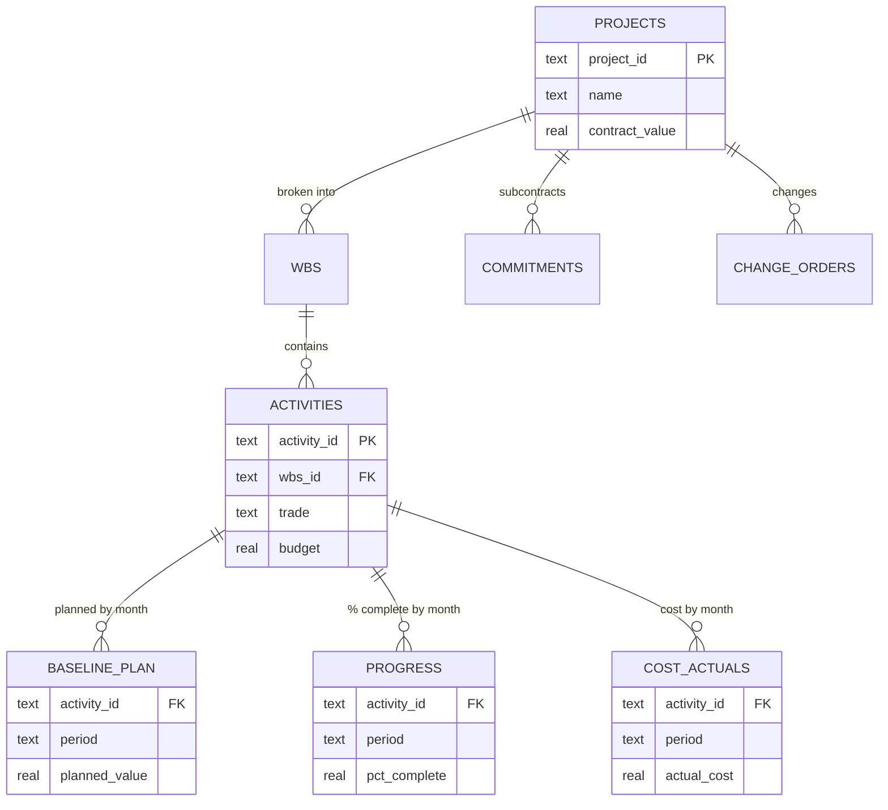
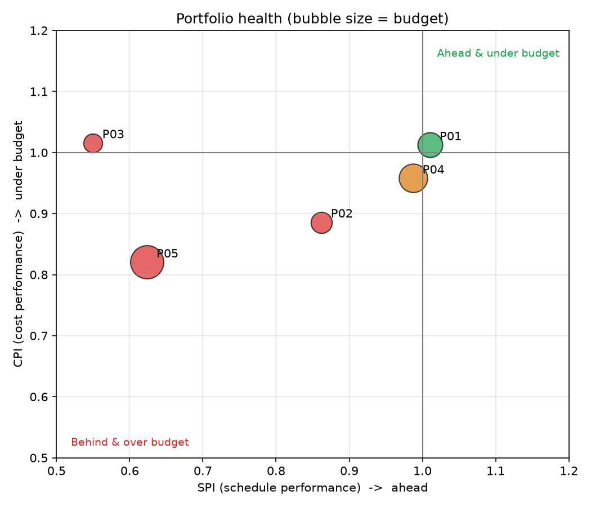
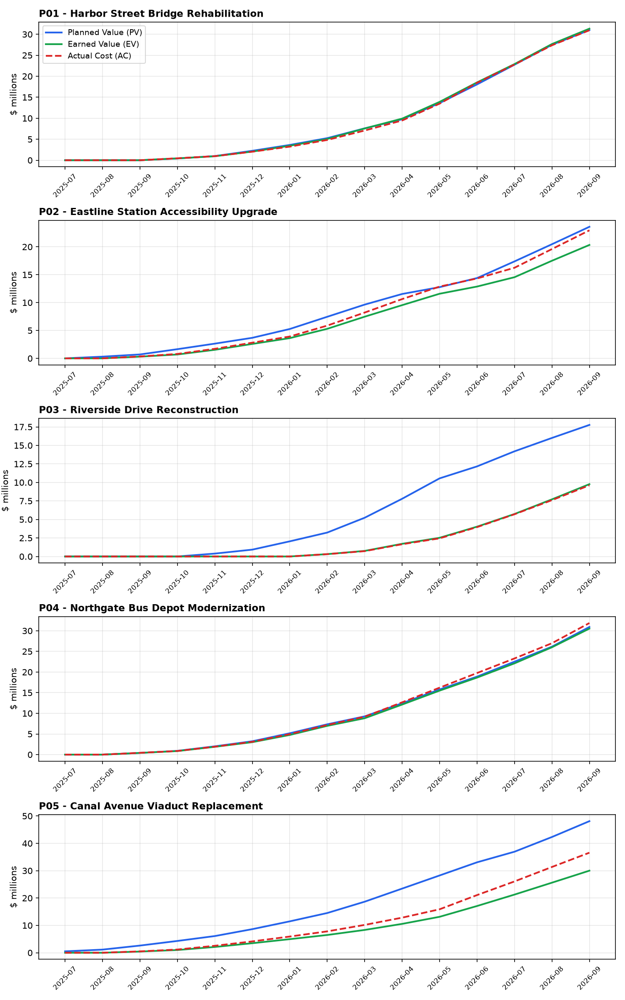

# Construction Program Controls Database & EVM Engine

**A SQL database and Python reporting pipeline that tracks cost and schedule performance across a multi-project infrastructure program using Earned Value Management (EVM).**


> **Bottom line (Sept 2026 status):** of 5 projects, 1 is healthy, 1 needs watching and 3 are in trouble. The Canal Avenue Viaduct is forecast to finish **$17.6M (22%) over budget** and is well behind schedule, driven mainly by concrete work bought above budget.

---

## The problem

An owner's program management team oversees several construction projects at once. Each month they need the same answers: which projects are over budget, which are behind schedule, what will each one cost at completion, and what's driving the problems. That data lives in the schedule, the cost system, subcontract logs and the change order register. This project brings it into **one relational database** and calculates EVM metrics with **SQL views**.

## The program (fictional sample data)

| ID | Project | Type | Borough |
|---|---|---|---|
| P01 | Harbor Street Bridge Rehabilitation | Bridge | Staten Island |
| P02 | Eastline Station Accessibility Upgrade | Rail | Bronx |
| P03 | Riverside Drive Reconstruction | Roadway | Manhattan |
| P04 | Northgate Bus Depot Modernization | Facility | Queens |
| P05 | Canal Avenue Viaduct Replacement | Bridge | Brooklyn |

About $290M in total contract value, 60 activities, and monthly data from mid-2025 to the **September 2026 status date**. All names and figures are fictional.

## Database design



## EVM metrics

| Metric | Formula | Meaning |
|---|---|---|
| PV (planned value) | Σ baseline_plan to date | Value of work scheduled so far |
| EV (earned value) | Σ budget × % complete | Value of work actually done |
| AC (actual cost) | Σ cost_actuals to date | What it cost |
| CPI | EV ÷ AC | Below 1 means over budget |
| SPI | EV ÷ PV | Below 1 means behind schedule |
| EAC | BAC ÷ CPI | Forecast final cost |
| VAC | BAC − EAC | Forecast overrun (negative) or underrun |

## Results

### Portfolio scorecard (status period: Sept 2026)

| Project | BAC | EV | AC | CPI | SPI | EAC | VAC | Status |
|---|---|---|---|---|---|---|---|---|
| P01 Harbor Street Bridge | $44.7M | $31.3M | $30.9M | 1.01 | 1.01 | $44.2M | +$0.5M | 🟢 Green |
| P02 Eastline Station | $32.5M | $20.3M | $23.0M | **0.89** | 0.86 | $36.7M | **−$4.2M** | 🔴 Red |
| P03 Riverside Drive | $25.9M | $9.8M | $9.6M | 1.02 | **0.55** | $25.5M | +$0.4M | 🔴 Red |
| P04 Northgate Bus Depot | $58.9M | $30.5M | $31.9M | 0.96 | 0.99 | $61.5M | −$2.6M | 🟡 Amber |
| P05 Canal Avenue Viaduct | $80.3M | $30.0M | $36.6M | **0.82** | **0.62** | $97.9M | **−$17.6M** | 🔴 Red |

<p align="center">
  
</p>

### S-curves: planned vs earned vs actual

<p align="center">
  
</p>

Reading the curves: when the **green line (EV) sits below the blue line (PV)**, the project is behind schedule. When the **red line (AC) sits above the green line (EV)**, it is spending more than it earns.

### Key findings ([`sql/03_analysis.sql`](sql/03_analysis.sql))

1. **Three projects need intervention.** P05 is over budget *and* behind schedule (CPI 0.82, SPI 0.62). P02 is over budget (CPI 0.89, a forecast $4.2M overrun). P03 is on budget but only 55% as far along as planned (SPI 0.55).
2. **Concrete is the biggest overrun driver.** It accounts for $3.9M of cost overrun program-wide (trade CPI 0.91), followed by steel ($1.9M) and civil ($1.7M).
3. **Part of the overrun was locked in at buyout.** P05's concrete subcontracts were awarded **$2.5M (9%) above budget**, so finding #2 started at procurement rather than in the field.
4. **P03's delay has a clear cause.** Excavation & base was due in August 2026 but is only 14% complete, and two of its utility and electrical activities are also overdue.
5. **Unforeseen conditions drive change orders.** They make up 37% of approved and pending CO dollars, followed by owner requests (32%) and design errors (21%, a potential recovery from the designer).
6. **Change orders are slow on the worst project.** P05 averages 47 days from submission to approval; the slowest single approval on the program took 72 days (P04).
7. **P04 scope has grown 8.8%.** It has $5.5M in approved changes plus $0.7M pending.
8. **At its current burn rate of $5.2M a month, P05 has about 12 months of work left** and $61.3M still to spend.

### Recommended actions

- **P05:** run a cost-to-complete review of concrete and steel, re-baseline the schedule, and speed up decisions on the $2.2M of pending change orders.
- **P03:** add resources to excavation and base to recover the critical path, since cost performance is healthy.
- **Program-wide:** compare buyout against budget *before* award, and track design-error change orders for recovery.

## SQL techniques used

Multi-table JOINs · CTEs (`WITH`) · CROSS JOIN to build an activity × month grid · correlated subqueries ("latest progress on or before this month") · window functions (`SUM() OVER (PARTITION BY ... ORDER BY ...)`) for cumulative totals · `CASE WHEN` status rules · conditional aggregation (`SUM(CASE ...)`) · `NULLIF` for safe division · date arithmetic with `julianday()` · `LIMIT/OFFSET` for rolling windows.

## Run it

```bash
pip install -r requirements.txt
python src/generate_data.py   # sample data -> data/*.csv
python src/load_db.py         # schema + data + views -> program.db
python src/report.py          # charts + portfolio_status.csv -> outputs/
```

## Project structure

```
├── sql/
│   ├── 01_schema.sql        # tables, keys, indexes
│   ├── 02_views_evm.sql     # EVM calculation views
│   └── 03_analysis.sql      # program management questions
├── src/
│   ├── generate_data.py     # realistic fictional program data
│   ├── load_db.py           # builds program.db
│   ├── run_query.py         # run any SQL from the terminal
│   └── report.py            # S-curves, CPI/SPI chart, status CSV
├── data/                    # generated CSVs
└── outputs/                 # charts and reports
```

## License

[MIT](LICENSE)
