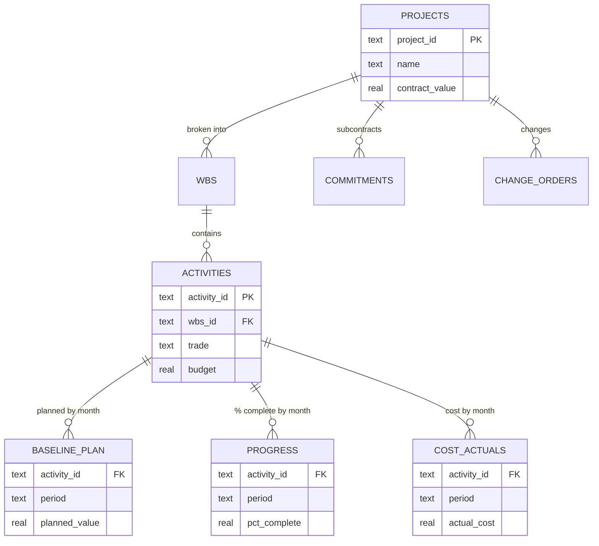

# Construction Program Controls Database & EVM Engine

**A SQL database and Python reporting pipeline that tracks cost and schedule performance across a multi-project infrastructure program using Earned Value Management (EVM).**


> 🚧 **Work in progress.** Schema, data pipeline and reporting are built. EVM views and analysis are being developed.

---

## The problem

An owner's program management team oversees several construction projects at once. Each month they need the same answers: which projects are over budget, which are behind schedule, what will each one cost at completion, and what's driving the problems. That data lives in the schedule, the cost system, subcontract logs and the change order register. This project brings it into **one relational database** and calculates EVM metrics with **SQL views**.

## The program (fictional sample data)

| ID | Project | Type | Borough |
|---|---|---|---|
| P01 | Harbor Street Bridge Rehabilitation | Bridge | Staten Island |
| P02 | Eastline Station Accessibility Upgrade | Rail | Bronx |
| P03 | Riverside Drive Reconstruction | Roadway | Manhattan |
| P04 | Northgate Bus Depot Modernization | Facility | Queens |
| P05 | Canal Avenue Viaduct Replacement | Bridge | Brooklyn |

About $290M in total contract value, 60 activities, and monthly data from mid-2025 to the **September 2026 status date**. All names and figures are fictional.

## Database design



## EVM metrics

| Metric | Formula | Meaning |
|---|---|---|
| PV (planned value) | Σ baseline_plan to date | Value of work scheduled so far |
| EV (earned value) | Σ budget × % complete | Value of work actually done |
| AC (actual cost) | Σ cost_actuals to date | What it cost |
| CPI | EV ÷ AC | Below 1 means over budget |
| SPI | EV ÷ PV | Below 1 means behind schedule |
| EAC | BAC ÷ CPI | Forecast final cost |
| VAC | BAC − EAC | Forecast overrun (negative) or underrun |

## Results

*Coming soon: S-curves, portfolio CPI/SPI chart, and key findings.*

## Run it

```bash
pip install -r requirements.txt
python src/generate_data.py   # sample data -> data/*.csv
python src/load_db.py         # schema + data + views -> program.db
python src/report.py          # charts + portfolio_status.csv -> outputs/
```

## Project structure

```
├── sql/
│   ├── 01_schema.sql        # tables, keys, indexes
│   ├── 02_views_evm.sql     # EVM calculation views
│   └── 03_analysis.sql      # program management questions
├── src/
│   ├── generate_data.py     # realistic fictional program data
│   ├── load_db.py           # builds program.db
│   ├── run_query.py         # run any SQL from the terminal
│   └── report.py            # S-curves, CPI/SPI chart, status CSV
├── data/                    # generated CSVs
└── outputs/                 # charts and reports
```

## License

[MIT](LICENSE)
